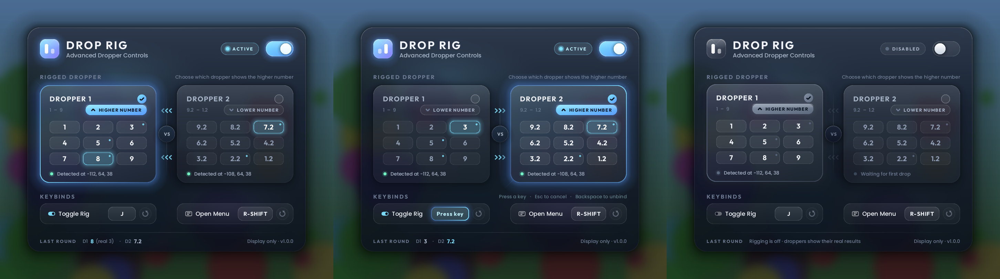

# Drop Rig

A client-side Fabric mod for Minecraft **1.21.11**. It shows the dropper you pick as the one
with the higher number **on your screen only**. It has a glass-style settings panel (DROP RIG),
a master toggle, and keybinds you can change in the panel.



## What it does and doesn't do

A dropper's result is chosen by the **server**: it picks a random slot and spawns that item. A
client mod receives the spawned item after the choice is made and has no way to influence it.
So Drop Rig is a **display mod**:

| | Changed by Drop Rig? |
|---|---|
| The item model and nameplate you see for the two dropped items | ✅ yes, on your client only |
| What the server actually dropped | ❌ no |
| What other players see | ❌ no |
| The item you pick up / your inventory | ❌ no (you get the real item) |
| Chat messages, scoreboards, plugin results, payouts | ❌ no |

The panel footer shows the real value next to the displayed one ("`D1 8 (real 3)`"), so you can
always tell what actually happened.

## Building it on GitHub

1. Create a new GitHub repository and upload **everything in this folder** (including
   `.github/`, `gradle/`, `gradlew`, `gradlew.bat`).
2. The **Build** workflow runs automatically on every push (or run it from the *Actions* tab →
   *Build* → *Run workflow*).
3. When it finishes, open the run and download the **drop-rig** artifact. It contains
   `drop-rig-1.1.0.jar`.

Building locally: `./gradlew build` (Java 21). The jar is in `build/libs/`.

## Installing

1. Install **Fabric Loader** 0.18.1 or newer for Minecraft **1.21.11**.
2. Put `drop-rig-1.1.0.jar` and **Fabric API** (for 1.21.11) in your `mods` folder.

## Using it

| Default key | Action |
|---|---|
| **Right Shift** | Open / close the DROP RIG panel |
| **J** | Toggle rigging ON / OFF (shows a message on the action bar) |

In the panel:

- **Toggle (top-right)**: master ON/OFF. The status pill next to it shows ACTIVE or DISABLED.
  Clicking the pill also toggles.
- **Dropper cards**: click a card to make it the rigged dropper. It gets the glowing border, the
  check mark and the **HIGHER NUMBER** badge. The other card shows **LOWER NUMBER**. The
  chevrons between the cards point at the rigged one.
- **Number chips**: a small dot marks outcomes that have been seen this session. The chip that
  was just shown lights up after each round.
- **Detected at x, y, z**: where each dropper was last seen firing.
- **Keybinds**: click a key to record a new one. Press any key to assign it, **Esc** to cancel,
  **Backspace/Delete** to unbind. ↺ resets to the default. A key already used by the other
  action is rejected with a red shake.

Everything is saved to `config/droprig.json` straight away and loaded on the next start.

### How rounds are detected

1. When an item entity appears, its name is read (entity nameplate first, then the item's custom
   name). The **last number** in the name is used, and colour codes are ignored.
2. Numbers 1–9 are Dropper 1 and 9.2–1.2 are Dropper 2. Anything else is ignored and never
   touched.
3. By default the item must appear next to a dropper or dispenser block, within 48 blocks of you.
4. A fresh item is hidden for 6 ticks (0.3 s) while the mod waits for the other dropper. Two items
   within 3 s and 12 blocks of each other count as one round.
5. If the rigged dropper is already higher, nothing changes. Otherwise **one** item is changed
   (the one that is still hidden if possible). It is changed to a random value from that
   dropper's own list that makes the rigged dropper higher. Dropper 1 never shows a decimal, and
   Dropper 2 never shows a whole number.
6. If that exact number has been seen before, the mod reuses the real item's appearance (item
   type, count, glint, name). Otherwise it edits just the number in the name and keeps the
   colours.
7. Turning rigging **OFF** restores every changed item and stops all tracking, hiding and
   relabelling.

### Config file (`config/droprig.json`)

| Key | Default | Meaning |
|---|---|---|
| `enabled` | `false` | Master toggle |
| `riggedDropper` | `1` | 1 or 2 |
| `toggleKey` / `menuKey` | `74` (J) / `344` (Right Shift) | GLFW key codes, `-1` = unbound |
| `dropper1Outcomes` | `"1"` … `"9"` | Dropper 1's numbers |
| `dropper2Outcomes` | `"9.2"` … `"1.2"` | Dropper 2's numbers |
| `holdTicks` | `6` | How long a fresh item is hidden while the mod waits for its partner (0 = never hide) |
| `pairWindowTicks` | `60` | Max ticks between the two drops of one round |
| `maxPairDistance` | `12` | Max blocks between the two items of one round |
| `detectionRadius` | `48` | Ignore items further than this from you |
| `requireDropperNearby` | `true` | Only consider items that appear next to a dropper or dispenser |
| `showToggleMessage` | `true` | Action-bar message when the toggle key is pressed |

If the file can't be read, it is renamed to `droprig.json.broken` and the defaults are used.

## Tests

`./gradlew test` (it also runs as part of `build`) runs 20 unit tests on the logic, which has no
Minecraft dependencies:

- **Every combination**: all 9 × 9 outcome pairs, both rigged droppers, every hidden/visible case,
  8 random seeds (5,184 rounds). The rigged dropper always shows the higher number, and each
  dropper only ever shows its own numbers.
- Rounds that are already correct are left alone. At most one item is changed, except in the one
  case where that isn't possible (Dropper 1 rigged, 1 vs 9.2).
- Unknown numbers, missing droppers and unpaired drops are never touched.
- Toggling OFF releases held items. Toggling ON works again. Switching the rigged dropper takes
  effect on the next round.
- Keybind rules: assigning, conflicts, Esc being reserved, unbinding, and reset.
- Config persistence: save, reload, broken files, and repairing invalid values.

### In-game checklist

The Minecraft-side code (rendering, mixins, entity hooks) can only be checked in the game:

1. Press Right Shift. The panel fades and scales in. Esc or Right Shift closes it with a fade.
2. Click the toggle. The knob slides, the pill changes ACTIVE/DISABLED, and the setting survives
   a restart.
3. Click each dropper card. The glow, check mark, badge and chevrons all move to that card.
4. Rebind Toggle Rig to another key, close the panel, press the new key. The action bar shows
   ON/OFF. The old key does nothing.
5. Fire both droppers with rigging ON. The selected dropper's item shows the higher number, and
   the footer shows the displayed and real values.
6. Toggle OFF and fire again. Both items show their real numbers.

## Project layout

```
src/main/java/com/droprig/
  DropRigClient.java        entrypoint, events, keybind handling
  core/                     pure logic (unit-tested): OutcomeTable, RigLogic, RigSession, NumberText, KeyBindings
  config/                   DropRigConfig + ConfigStore (JSON)
  rig/                      DisplayRigger: item entities ↔ RigSession, relabelling, restore
  gui/                      DropRigScreen (Minecraft), DropRigView (layout/animation/hit-testing), McText
  gui/render/               Gfx: anti-aliased rounded shapes, shadows, glows; fonts; easing
  mixin/                    render hold, raw key hook, GUI render-state accessor
src/main/resources/assets/droprig/font/   Outfit + Poppins TrueType fonts (SIL OFL)
```

The GUI submits its own anti-aliased geometry to Minecraft's GUI renderer as one element per
frame, with vector TrueType text layered on top. It uses the vanilla menu blur behind it for the
frosted-glass look.
